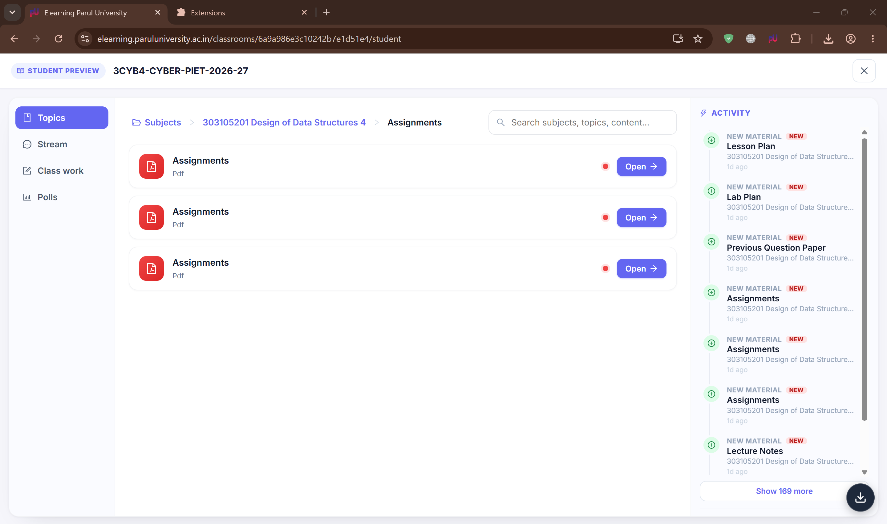
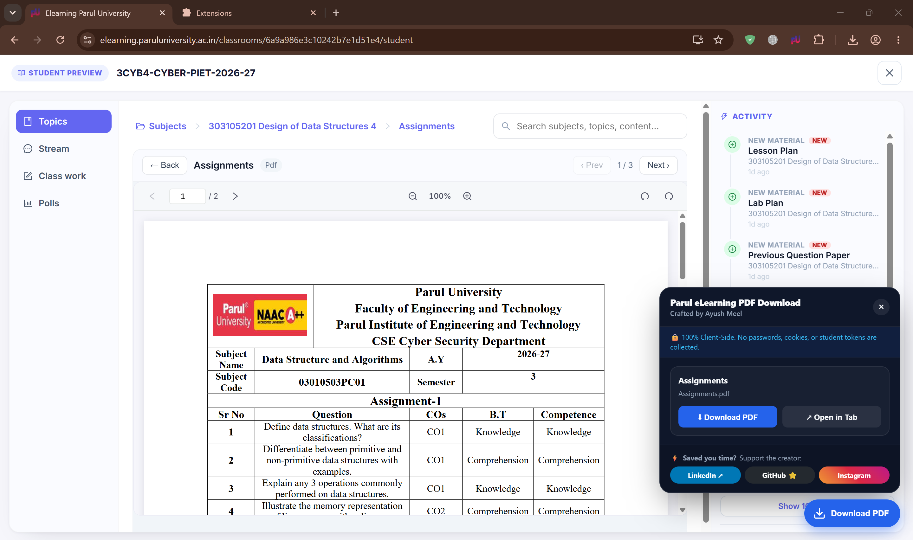

# 🚀 Parul eLearning PDF Download

> **One-click lecture slides, syllabus booklets, and reference document downloader for Parul University students — universal support across Chrome, Firefox, Safari, Android, and iOS.**

[](https://meel-ayush.github.io/parul-elearning-pdf-download/)
[](https://github.com/meel-ayush/parul-elearning-pdf-download)
[](https://developer.chrome.com/docs/extensions/mv3/intro/)
[](https://meel-ayush.github.io/parul-elearning-pdf-download/privacy.html)
[](#architecture)
[](LICENSE)

**[👉 Click Here to See Setup & Installation Guide](https://meel-ayush.github.io/parul-elearning-pdf-download/)** · **[Privacy Policy](https://meel-ayush.github.io/parul-elearning-pdf-download/privacy.html)** · **[GitHub](https://github.com/meel-ayush/parul-elearning-pdf-download)** · **[LinkedIn](https://www.linkedin.com/in/ayushmeel)**

---

## 📌 Table of Contents

1. [Setup & Installation Guide](#setup--installation-guide)
2. [The Problem](#the-problem)
3. [My Solution](#my-solution)
4. [Screenshots](#screenshots)
5. [Key Features](#key-features)
6. [Architecture](#architecture)
7. [Project Structure](#project-structure)
8. [Security & Privacy Policy](#security--privacy-policy)
9. [Author](#author)
10. [License](#license)

---

## 🚀 Setup & Installation Guide

> ### ⚡ **[👉 Click Here to Open the Live Setup & Installation Guide 👈](https://meel-ayush.github.io/parul-elearning-pdf-download/)**
>
> **Get set up in under 60 seconds — zero terminal commands or complicated configurations required:**
> 1. 🌐 **Open the Page:** Tap or click the link above to launch the universal self-service setup portal.
> 2. 📱 **Select Your Device:** Choose your platform — **Android Mobile**, **iPhone & iPad**, or **Desktop Computers (Windows, Mac & Linux)**.
> 3. 🎬 **Watch the Video or Read the Steps:** Follow along with the built-in 1-minute video walkthrough or read the crystal-clear visual steps tailored specifically for your browser!

| Your Device | Delivery Mechanism | Supported Browsers | Direct Setup Walkthrough |
| :--- | :--- | :--- | :---: |
| 🤖 **Android Mobile** | Memory-Stream Bookmarklet | Chrome, Brave, Opera, Samsung Internet | [**Open Android Setup Guide →**](https://meel-ayush.github.io/parul-elearning-pdf-download/android.html) |
| 🍎 **iPhone & iPad** | Apple Shortcut & WebKit Bookmarklet | Safari (Share Sheet), Google Chrome iOS | [**Open iOS Setup Guide →**](https://meel-ayush.github.io/parul-elearning-pdf-download/ios.html) |
| 💻 **Desktop Computers** | Production MV3 & Gecko Extension | Google Chrome, Brave, MS Edge, Firefox, Safari | [**Open Desktop Setup Guide →**](https://meel-ayush.github.io/parul-elearning-pdf-download/desktop.html) |

---

## 🚨 The Problem

Parul University students use the university eLearning portal (`elearning.paruluniversity.ac.in`) daily for lecture presentations, syllabi, and study notes. However, accessing materials for offline study or exam revision is deliberately restricted:

- 🔒 **Obfuscated Embedded Viewers:** Course documents are locked inside shadow DOMs, nested iframes, or custom Angular PDF viewers (`ngx-extended-pdf-viewer`), completely disabling standard browser right-click "Save As..." actions.
- 🔑 **Cryptographically Signed URLs:** Files are hosted on DigitalOcean Spaces using pre-signed HMAC query parameters (`AWSAccessKeyId`, `Signature`, `Expires`). Standard extractors truncate queries at ampersands (`&`), breaking authentication and resulting in `403 Forbidden` errors.
- 📱 **Zero Mobile Extension Support:** Mobile Chrome on Android and Safari on iOS do not support desktop web extension stores, leaving phone and tablet users completely unable to save lecture slides.

**I built Parul eLearning PDF Download to fix that.**

---

## 💡 My Solution

A unified, lightweight, local-first engineering utility that gives students instantaneous, 1-click access to their course materials on whatever device they have in front of them:

- **Desktop Computers (Chrome, Brave, Edge, Firefox, Safari):** A production browser extension that automatically detects open lecture documents and injects an unobtrusive floating **Download PDF** HUD directly onto the page.
- **Android Mobile:** An in-memory blob streaming bookmarklet that downloads lectures straight into the device's native `Downloads/` directory in the background — opening **zero blank tabs**.
- **Apple iOS (iPhone & iPad):** An official 1-Tap **Apple Shortcut** integrated into Safari's native Share Sheet (`[↑]`), alongside zero-app bookmarklets for both Safari and Chrome for iOS.

One suite. Every device. Complete freedom to study offline.

---

## 📸 Screenshots

<p align="center">
  <b>Classroom Floating HUD Injected</b><br/>
  
</p>
<br/>
<p align="center">
  <b>Expanded Download & Preview Controls</b><br/>
  
</p>

> 📂 *All high-resolution interface captures are stored in the [`screenshots/`](screenshots/) directory.*

---

## ✨ Key Features

### ⚡ Multi-Stage Heuristic Detection
- **Comprehensive Selector Scan:** Queries Angular custom elements (`ngx-extended-pdf-viewer`), nested `<iframe>` trees, `<embed>`, `<object>`, and active network resource logs.
- **Zero Layout Thrashing:** Lightweight evaluation engine that avoids layout reflow.
- **MutationObserver Driven:** Instantly responds to dynamic single-page application (SPA) route changes when navigating between lecture units.

### 🔐 Cryptographic Parameter Preservation
- Built strictly upon the **WHATWG URL & URLSearchParams standard**.
- Retains complete DigitalOcean HMAC authentication tokens without dropping query parameter bytes or signature tokens.

### 🧹 Original Filename Sanitizer
- Automatically strips server-generated UUID prefixes (e.g., `8f7b3a12-9c4e-4f81-b5d2-0123456789ab-Unit_1_Notes.pdf` &rarr; `Unit_1_Notes.pdf`).
- Eliminates filesystem directory traversal characters (`../`) for safe local file persistence.

### 📱 Zero-Tab Android Streamer
- Streams file bytes via an in-memory `Blob` and synthetic anchor dispatch.
- Downloads directly into the device's native `Downloads/` directory without spawning ghost tabs or leaving classroom view.

### 🍎 Native Apple Shortcut Integration
- Deeply integrated into iOS via Apple's native Shortcuts system.
- Available directly inside Safari's system Share Sheet (`[↑]`) with full permission-remembering support.

### 🔒 100% Local-First & Zero Telemetry
- No tracking pixels, analytics SDKs, cookies, or external server calls.
- Runs exclusively within browser memory during your active study session.

---

## 🏗️ Architecture

```text
                        PARUL E-LEARNING PORTAL
                                   │
      ┌────────────────────────────┴────────────────────────────┐
      ▼                                                         ▼
[Desktop Extension]                                   [Mobile Runtime Engine]
      │                                                         │
   DOM Scan & MutationObserver                               Multi-Tier Cascade Scan
   (ngx-extended-pdf-viewer / iframe)                        (DOM ➔ URL Params ➔ Perf Log)
      │                                                         │
      ▼                                                         ▼
Origin & Protocol Verification                            Strict Host Boundary Validation
(*.digitaloceanspaces.com / *.paruluniversity.ac.in)      (Rejects malformed userinfo / port spoofing)
      │                                                         │
      ▼                                                         ▼
Background Service Worker                                 In-Memory Blob Stream (Android)
(chrome.downloads API w/ Sanitize)                        WebKit Transient Activation (iOS)
      │                                                         │
      ▼                                                         ▼
Native Downloads Directory                                Native Files / System Viewer
```

---

## 📂 Project Structure

```text
parul-elearning-pdf-download/
├── README.md                                 # Master project documentation
├── LICENSE                                   # CC BY-NC 4.0 legal license
├── screenshots/                              # High-resolution documentation captures
│   ├── preview-classroom-hud.png             # Classroom injection capture
│   └── preview-download-panel.png            # Floating download HUD expanded capture
├── extensions/                               # Production browser extension source trees
│   ├── chrome/                               # Chromium Manifest V3 (Chrome, Brave, Edge, Opera)
│   │   ├── manifest.json
│   │   ├── content.js
│   │   ├── service-worker.js
│   │   └── icons/
│   ├── firefox/                              # Firefox Gecko MV3 (Mozilla Firefox)
│   │   ├── manifest.json
│   │   ├── content.js
│   │   ├── service-worker.js
│   │   └── icons/
│   └── safari/                               # Safari WebKit MV3 (Apple Safari macOS)
│       ├── manifest.json
│       ├── content.js
│       └── icons/
└── docs/                                     # Interactive web portal
    ├── index.html                            # Universal device selector hub
    ├── desktop.html                          # Desktop (Windows, Mac, Linux) setup guide
    ├── android.html                          # Android setup guide & video walkthrough
    ├── ios.html                              # iPhone & iPad setup guide (Shortcut vs Bookmarklet)
    ├── privacy.html                          # Local-first privacy policy
    ├── logo.png                              # Brand visual asset
    ├── icons/                                # Multi-resolution favicon & app icons
    └── videos/                               # Step-by-step video tutorials
        ├── tutorial-android-bookmarklet.mp4
        ├── tutorial-ios-shortcut.mp4
        ├── tutorial-ios-safari.mp4
        └── tutorial-ios-chrome.mp4
```

---

## 🔒 Security & Privacy Policy

- **Zero Data Collection:** No user analytics, session cookies, tracking pixels, or third-party telemetries are bundled. All processing occurs locally in tab memory.
- **Strict Host Isolation:** Extensions execute exclusively on verified domain patterns matching `*://*.paruluniversity.ac.in/*` and `*://*.edorer.com/*`.
- **Authorization Unchanged:** This utility does not bypass authentication, decrypt DRM-protected assets, or elevate student privileges. It merely exposes download triggers for educational files that the active student session has already authenticated and fetched.
- **Content Security Policy Integrity:** Injected DOM HUDs utilize isolated shadow boundaries and inline SVG elements to avoid violating university CSP directives (`script-src`, `connect-src`).
- **Complete Privacy Policy:** Read the full legal terms and commitment at **[Live Privacy Policy](https://meel-ayush.github.io/parul-elearning-pdf-download/privacy.html)**.

---

## 👨‍💻 Author

**Ayush Meel**

[](https://github.com/meel-ayush)
[](https://www.linkedin.com/in/ayushmeel)

---

## ⚖️ License

This project is licensed under the **[Creative Commons Attribution-NonCommercial 4.0 International (CC BY-NC 4.0)](LICENSE)** license.

You are free to share and adapt the material for non-commercial educational purposes with appropriate credit to the author. Commercial use requires explicit permission.

*Disclaimer: This is an independent open-source community utility developed for educational accessibility. It is not affiliated with, endorsed by, or sponsored by Parul University or Edorer. All university trademarks and logos remain the property of their respective owners.*
